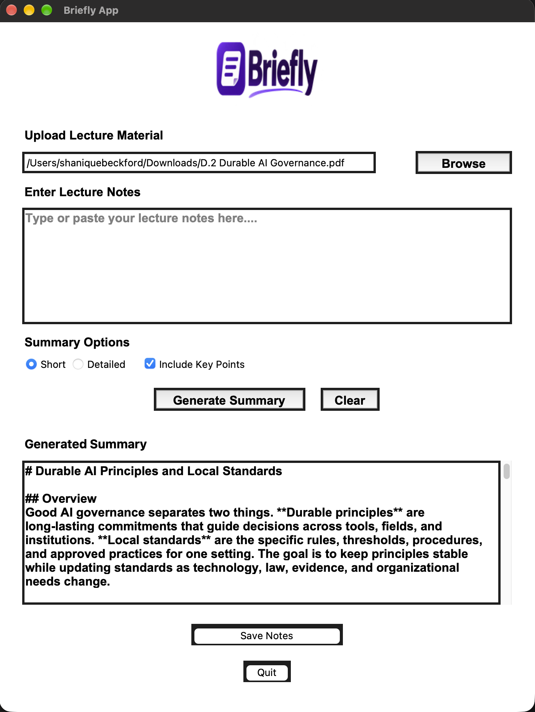

<p align="center">
  
</p>

# Briefly – Lecture-to-Notes Summarizer

Briefly is a Python desktop app that turns long, unorganized lecture material into clear, structured study notes. Upload a PDF or text file (or paste your notes), choose a summary style, and Briefly uses the Claude API to pick out the key concepts and turn them into scannable bullet points. You can then save the result as a Markdown file.



## Course

**Final Project** – Contemporary Business Applications Development I (MIS 310)
Central Connecticut State University · Dr. Armel Djangone · Fall 2026

**Group 2:** Hassan Kafel, Alex Tutka, Barbara Patricio-Flores, Shanique Beckford, Shima Shoubah

## The Problem

Students have to process a lot of information from several classes in a short time, and notes taken by hand are often inconsistent and miss key points. Briefly automates the organizing step so students can spend their time understanding the material. The same approach could also be used to summarize business meetings, training sessions, or long reports.

## Features

- **Upload PDF or TXT files** (text is extracted with `pypdf`), or type/paste notes directly
- **Short or Detailed** summary options
- **Include Key Points** option for a "key points to remember" section
- **AI summarization** with Claude, which is instructed to use only the lecture material and not invent information
- **Save as Markdown (.md)** or text file
- **Clear** to reset the form and **Quit** to exit
- Placeholder text, a scrollable read-only output box, and error and confirmation message boxes

## Technologies Used

| Library | Purpose |
|---|---|
| `tkinter` (+ `filedialog`, `messagebox`) | GUI: window, buttons, text boxes, file dialogs, alerts |
| `anthropic` | Official Claude API SDK for generating summaries |
| `pypdf` | Extracts text from uploaded PDF files |
| `Pillow` (PIL) | Loads, resizes, and displays the Briefly logo with a transparent background |
| `pathlib` | Checks file extensions and reads text files |
| `os` | Reads the API key from an environment variable |

**API:** Anthropic Claude Messages API (`claude-sonnet-5-5`, max 5,000 output tokens)

## How to Run

1. **Install Python 3** from [python.org](https://www.python.org/downloads/).
2. **Install the required packages:**
   ```bash
   pip install -r requirements.txt
   ```
3. **Set your Anthropic API key** as an environment variable. Don't paste it into the code.
   - macOS / Linux:
     ```bash
     export ANTHROPIC_API_KEY="your-key-here"
     ```
   - Windows (Command Prompt):
     ```cmd
     set ANTHROPIC_API_KEY=your-key-here
     ```
   - PyCharm: **Run → Edit Configurations → Environment variables**, then add `ANTHROPIC_API_KEY`.
4. **Run the app** from inside the project folder, so the app can find its logo (`image 1.png`):
   ```bash
   python final_project.py
   ```

## Project Files

| File | Description |
|---|---|
| `final_project.py` | The full Briefly application |
| `image 1.png` | Briefly logo shown at the top of the app |
| `requirements.txt` | Python packages the app needs |

## How to Use

1. Click **Browse** to upload a PDF or text file, or type your notes in the text box.
2. Choose **Short** or **Detailed**, and check **Include Key Points** if you want them.
3. Click **Generate Summary**. Your notes appear in the Generated Summary box.
4. Click **Save Notes (.md)** to export them.
5. Click **Clear** to start over, or **Quit** to close the app.

## What We Learned

- Building a GUI with Tkinter and connecting widgets to functions and events
- Handling file uploads and extracting text from PDFs
- Connecting to an AI API securely using environment variables
- Error handling with `try/except` and user-facing message boxes
- Testing each part of an application to make sure the features work together

## References

- [Python Docs – Graphical user interfaces with Tk](https://docs.python.org/3/library/tk.html)
- [Python Docs – Tkinter dialogs](https://docs.python.org/3/library/dialog.html)
- [Claude Platform Docs](https://platform.claude.com/docs/en/home)
